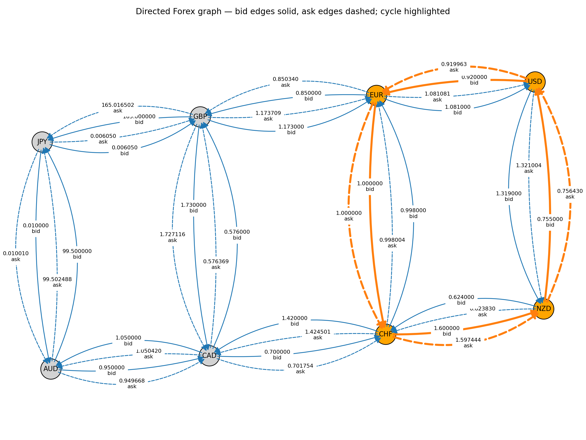
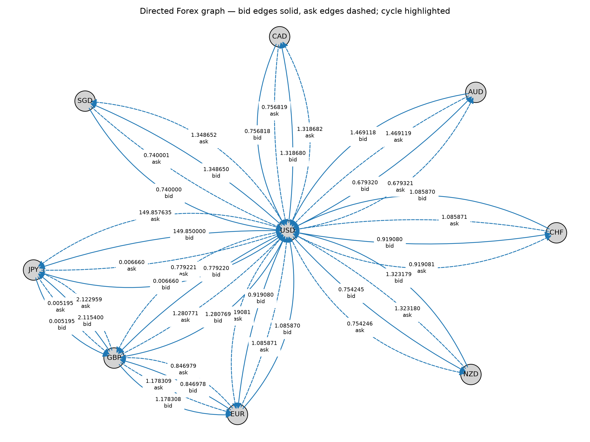

# Forex Arbitrage Detector

A command-line tool that finds and visualizes currency arbitrage cycles. It models the
forex market as a weighted directed graph and uses the **Bellman-Ford algorithm** to detect
negative-weight cycles, which correspond to profitable trade loops.

Started as a course project for **MTL732 – Financial Mathematics** (IIT Delhi).

## How it works

1. Each currency is a node. Each quote `A/B` produces two directed edges:
   - `A -> B` at the **bid** price: `rate = bid * (1 - fee)`
   - `B -> A` at the **ask** price: `rate = (1 / ask) * (1 - fee)`
2. A cycle is profitable when the product of its rates is greater than 1:
   `R1 * R2 * ... * Rn > 1`.
3. Taking `weight = -log(rate)` turns that product into a sum, so a profitable cycle becomes a
   **negative-weight cycle**.
4. Bellman-Ford runs `V - 1` relaxation rounds, then one more pass. All distances start at 0,
   so no source currency is needed and a cycle anywhere in the graph is found. If any distance
   still improves, a negative cycle exists, and the parent array is used to reconstruct it.
5. The real profit is recomputed from the actual leg rates and the cycle is drawn with
   NetworkX and Matplotlib.

Time complexity is `O(V * E)` and space complexity is `O(V + E)`.

## Features

- Detects triangular arbitrage and longer cycles of any length
- Models per-trade fees, a minimum profit threshold, and bid/ask spreads
- Reads static CSV quotes, or fetches data through `yfinance`
- Draws the currency graph: bid edges solid, ask edges dashed, the arbitrage cycle highlighted in orange

## Project structure

```
forex-arbitrage-detector/
├── fx_arbitrage.py      # the tool
├── requirements.txt
├── data/                # sample quotes (quotes.csv, no_arbitrage.csv)
└── images/              # example graphs used in this README
```

## Installation

Requires Python 3.8 or newer.

```bash
git clone https://github.com/<your-username>/forex-arbitrage-detector.git
cd forex-arbitrage-detector
python -m venv venv
# Windows: venv\Scripts\activate      macOS/Linux: source venv/bin/activate
pip install -r requirements.txt
```

All three packages are needed even for CSV mode, because the script imports them at startup.

## Usage

```bash
# From a CSV file
python fx_arbitrage.py --csv data/quotes.csv --draw --out graph.png

# With a fee and a minimum profit threshold (both are decimal fractions)
python fx_arbitrage.py --csv data/quotes.csv --fee 0.0002 --min-profit-pct 0.001 --draw

# Fetch data from Yahoo Finance (slow: one request per ticker, takes several minutes;
# pairs that Yahoo has no quote for are skipped)
python fx_arbitrage.py --live --draw --out graph.png
```

| Flag | Description |
|---|---|
| `--csv PATH` | CSV with header `pair,bid,ask` |
| `--live` | Fetch quotes from Yahoo Finance; they are saved to `real_data.csv` |
| `--fee` | Per-trade fee as a decimal fraction (`0.0002` = 0.02%). Default `0.0` |
| `--min-profit-pct` | Minimum total cycle profit as a decimal fraction. Default `1e-6` |
| `--draw` | Save the graph visualization |
| `--out` | Output image filename. Default `graph.png` |
| `--show` | Open the plot window after saving |

### CSV format

```
pair,bid,ask
EUR/USD,1.0810,1.0870
USD/JPY,149.85,150.15
```

## Example

`data/quotes.csv` is a hand-built test dataset with a planted arbitrage opportunity:

```
Arbitrage found!
Cycle: EUR -> CHF -> NZD -> USD -> EUR
Start 1 EUR -> end 1.1134644478 EUR
Profit %: 11.34644478
```



`data/no_arbitrage.csv` is a consistent market and correctly reports `No arbitrage found`.




### Live-data example

Running `--live` fetches quotes for every ordered pair of 19 currencies (342 tickers). In one
run, 304 quotes were returned; the rest were skipped because Yahoo has no quote for them. The
quotes are saved to `real_data.csv`, which is git-ignored and re-created on every run.

**Run 1: a timing artifact.** The tool reported a 0.94% BRL -> USD -> BRL cycle:

```
Arbitrage found!
Cycle: BRL -> USD -> BRL
Start 1 BRL -> end 1.0093853473 BRL
Profit %: 0.93853473
```

This is not a real opportunity. `BRLUSD=X` and `USDBRL=X` are fetched as two separate tickers
whose prices were not taken at the same moment, and the gap between them is larger than the
0.02% synthetic spread the tool adds. A real two-way market would not allow a profit on a round
trip between the same two currencies.

**Run 2: a bad data point.** Re-running the saved file with a 0.5% fee

```
python fx_arbitrage.py --csv real_data.csv --fee 0.005
```

reported an absurd +888% cycle, INR -> BRL -> INR:

```
Arbitrage found!
Cycle: INR -> BRL -> INR
Start 1 INR -> end 9.8825790438 INR
Profit %: 888.25790438
```

The cause is a single wrong quote from Yahoo in the saved data:

```
INR/BRL,0.5251,0.5256
BRL/INR,19.01,19.06
```

A pair and its inverse should multiply to roughly 1, but these multiply to about 10. The
consistent value for `INR/BRL` is about 1/19.01 = 0.0526, so Yahoo's quote is off by a factor of 10.
The algorithm did its job: it found a profitable loop in the numbers it was given, but the
numbers were wrong.

**Takeaway:** any large profit on live data should be read as a data-quality problem, not an
opportunity. Live results vary from run to run, and this tool does not filter bad quotes.


## Limitations

- **The 11% profit above is an artifact of synthetic test data**, not a real market opportunity.
- Yahoo Finance does not provide simultaneous real-time bid/ask quotes. In `--live` mode the tool
  uses Yahoo's `bid`/`ask` when present; otherwise it takes the last available price and applies a
  **synthetic spread** (0.02% of price). Quotes are also not taken at the same instant, so apparent
  opportunities in live mode are usually timing artifacts, and results are for demonstration only.
- Fees are modeled as a single percentage. Slippage, liquidity and execution latency are not modeled.
- Bellman-Ford finds *a* negative cycle, not necessarily the *most profitable* one.
- This is an educational project, not a trading bot.
- `--live` mode does not validate quotes; a single mis-scaled price from Yahoo can produce an absurd cycle (see the live-data example).

## Future work

- Use a low-latency API with true bid/ask quotes
- Search for the maximum-profit cycle
- Model trade size and liquidity
- Backtest on historical tick data

